# Nguyen Van Quoc Bao

**Backend-focused developer · C# / ASP.NET Core · FPT University**

I'm a third-year student in Vietnam building **APIs, data-driven applications, and real-time features**. I focus on clear API contracts, sensible data models, and testable backend code.

[Email](mailto:baonvq161@gmail.com) · [LinkedIn](https://www.linkedin.com/in/b%E1%BA%A3o-qu%E1%BB%91c-411506369/) · [Selected work](#selected-work) · [Tech stack](#tech-stack)

## Selected work

<table role="presentation">
  <tr>
    <td colspan="2">
      <code>FEATURED / C# + ASP.NET CORE</code>
      <h3><a href="https://github.com/161seconds/shuttle-sync">ShuttleSync</a></h3>
      
A sports booking and club management platform covering court bookings, tournaments, chat, reviews, and AI coaching.

      
<strong>Backend focus:</strong> API, Service, and Repository layers; MongoDB-backed workflows; cookie authentication; real-time updates with SignalR.

      
<code>C#</code> <code>ASP.NET Core</code> <code>MongoDB</code> <code>SignalR</code> <code>xUnit</code>

      
<a href="https://github.com/161seconds/shuttle-sync#architecture">Architecture &amp; setup</a> · <a href="https://github.com/161seconds/shuttle-sync/tree/main/ShuttleSync.Service">Business logic</a> · <a href="https://github.com/161seconds/shuttle-sync/tree/main/ShuttleSync.Test">Integration tests</a>

    </td>
  </tr>
  <tr>
    <td width="50%" valign="top">
      <code>REAL-TIME SYSTEMS</code>
      <h3><a href="https://github.com/161seconds/gps">GPS Realtime</a></h3>
      
A shared map with road routing, synchronized endpoints, and live GPS updates across devices.

      
<strong>Engineering focus:</strong> SignalR broadcasts, routing responses, and reconnect state.

      
<code>.NET</code> <code>SignalR</code> <code>Leaflet</code> <code>JavaScript</code>

      
<a href="https://github.com/161seconds/gps/blob/main/Program.cs">Server</a> · <a href="https://github.com/161seconds/gps/blob/main/scripts/check.mjs">Checks</a> · <a href="https://github.com/161seconds/gps#run-locally">Run locally</a>

    </td>
    <td width="50%" valign="top">
      <code>AI + DATA</code>
      <h3><a href="https://github.com/161seconds/one61-rag">One61 RAG</a></h3>
      
A logistics assistant combining warehouse SQL queries, document retrieval, and AI answers with source citations.

      
<strong>Engineering focus:</strong> FastAPI endpoints, retrieval pipelines, and response verification.

      
<code>Python</code> <code>FastAPI</code> <code>PostgreSQL</code> <code>Qdrant</code>

      
<a href="https://github.com/161seconds/one61-rag/blob/main/src/agents/pipeline.py">Pipeline</a> · <a href="https://github.com/161seconds/one61-rag/tree/main/tests">Tests</a> · <a href="https://github.com/161seconds/one61-rag#local-setup">Run locally</a>

    </td>
  </tr>
  <tr>
    <td colspan="2">
      <code>DOCUMENTATION + PRACTICE</code>
      <h3><a href="https://github.com/161seconds/revision-document">Revision Documents</a></h3>
      
A curated engineering knowledge base with revision notes, cheat sheets, runnable examples, and practice labs.

      
<strong>Learning focus:</strong> API contracts, PostgreSQL concurrency, .NET integration testing, and reliable payment workflows.

      
<code>.NET</code> <code>PostgreSQL</code> <code>Testing</code> <code>System design</code>

      
<a href="https://github.com/161seconds/revision-document/tree/main/api-contracts">API contracts</a> · <a href="https://github.com/161seconds/revision-document/tree/main/postgresql-concurrency">Concurrency labs</a> · <a href="https://github.com/161seconds/revision-document/tree/main/dotnet-integration-testing">Integration testing</a>

    </td>
  </tr>
</table>

[More projects and experiments](https://github.com/161seconds?tab=repositories)

## Tech stack

     

| Area | Technologies |
| :--- | :--- |
| Backend | C#, ASP.NET Core, Entity Framework Core, REST APIs, SignalR |
| Databases | PostgreSQL, SQL Server, MySQL, MongoDB |
| Other languages | Python, Java, C, C++ |
| Web & design | JavaScript, TypeScript, HTML, CSS, Vite, Figma |
| Workflow & deployment | Git, GitHub Actions, Docker, Vercel |
| AI tools | OpenAI Codex |

## Current focus

<table role="presentation">
  <tr>
    <td width="50%" valign="top">
      <code>01</code> BACKEND DEPTH
      <h3>Go deeper with .NET</h3>
      
ASP.NET Core, clean architecture, and services that are easy to test.

    </td>
    <td width="50%" valign="top">
      <code>02</code> API DESIGN
      <h3>Design for growth</h3>
      
RESTful APIs, service boundaries, and microservices trade-offs.

    </td>
  </tr>
  <tr>
    <td width="50%" valign="top">
      <code>03</code> SYSTEM DESIGN
      <h3>Learn the trade-offs</h3>
      
Caching, Redis, queues, and rate limiting through practical experiments.

    </td>
    <td width="50%" valign="top">
      <code>04</code> BUILD &amp; CONTRIBUTE
      <h3>Ship useful work</h3>
      
Real-world projects and open-source contributions that turn learning into practice.

    </td>
  </tr>
</table>

## GitHub activity

  
  

  

  <picture>
    <source media="(prefers-color-scheme: dark)" srcset="https://raw.githubusercontent.com/161seconds/161seconds/output/github-contribution-grid-snake-dark.svg" />
    
  </picture>

  

## Get in touch

For backend opportunities, project discussions, or collaboration:

**[baonvq161@gmail.com](mailto:baonvq161@gmail.com)** · **[LinkedIn](https://www.linkedin.com/in/b%E1%BA%A3o-qu%E1%BB%91c-411506369/)**

Elsewhere: [Facebook](https://www.facebook.com/baroosipp) · [Instagram](https://www.instagram.com/_baoo.161_/)

Consistency over motivation.
